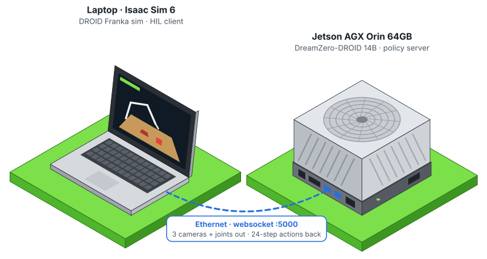
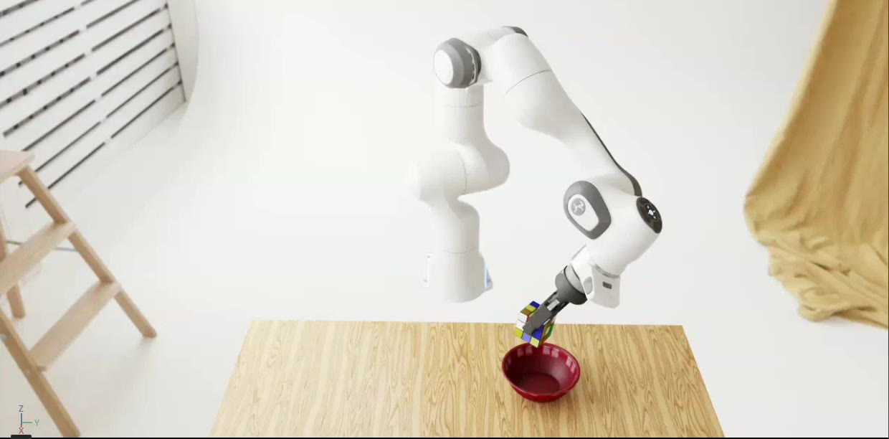

# jetson-orin-agx-hil-dreamzero



Project page: https://kabilankb.github.io/jetson-orin-agx-hil-dreamzero/

[](docs/assets/dreamzero-orin-sim.mp4)

*DreamZero-DROID on the Orin driving the Isaac Sim 6 DROID scene ("put the cube in the bowl"). Click for the video.*

Hardware-in-the-loop for **NVIDIA DreamZero-DROID** with the policy running on a **Jetson AGX Orin 64GB** and a
Franka + Robotiq DROID scene in **Isaac Sim 6 / Isaac Lab 3** on a laptop.

```
 Laptop (Isaac Sim 6 / Isaac Lab 3)                        Jetson AGX Orin 64GB (JetPack 7)
 ┌───────────────────────────────────┐   websocket :5000   ┌───────────────────────────────────┐
 │ DROID scene: Franka + Robotiq 2F-85│ ── 3 cams 180x320 ─▶│ DreamZero-DROID 14B (bf16, 47 GB) │
 │ 2 external + wrist camera, 15 Hz  │    7 joints, grip   │ single GPU, low-memory loader     │
 │ dreamzero_hil.client              │ ◀─ 24 x (7 joints ──│ jetson/run_dreamzero_server.sh    │
 └───────────────────────────────────┘      + gripper)     └───────────────────────────────────┘
```

DreamZero ([dreamzero0/dreamzero](https://github.com/dreamzero0/dreamzero)) is a world-action model that
predicts video and actions jointly; its README targets 2× H100/GB200. This repo makes the DROID checkpoint run on
**one Orin** and closes the loop with a simulated DROID robot.

## Results (Jetson AGX Orin 64GB, L4T R39.2.1, torch 2.14.1+cu130)

| | |
|---|---|
| Model load | ~40 s (streams 10 shards; 2146 tensors, 0 missing) |
| Memory | 47 GB after load; text encoder offloaded after the prompt is encoded; plateaus at ~58 / 61 GB after 4 chunks (DreamZero caps its AR context at `max_chunk_size: 4`). A **new prompt** at the plateau needs the 11.4 GB encoder back (see [Benchmark](#benchmark)) |
| Latency | ~60 s per request → 24-step action chunk (1.6 s of robot motion at 15 Hz). First request ~70 s. |
| Reference | ~3 s on 2× H100, ~0.6 s on GB200 (DreamZero README) |

It is slow but correct: the first chunk for "put the cube in the bowl" is a smooth reach starting at the current
pose (shoulder +0.25 rad), and requests with one prompt run indefinitely without running out of memory. Switching
prompts is the tight spot: the text encoder must be reloaded on top of the ~58 GB plateau. It was OOM-killed once
(another session had left the server at 60 GB); `dz_lowmem` now returns PyTorch's cached memory before the reload
and logs how much is free. In the benchmark the reload ran with 7.8 GB free for 11.4 GB of weights and succeeded,
so treat prompt switches as close to the limit.

## Benchmark

`scripts/bench.sh` runs the loop end to end and writes `runs/bench_<time>/report.md` and `summary.json`:
**time to finish each task**, the **action-chunk pipeline** (where each request's time goes, payload sizes, how
much of each chunk is used) and **overall multi-task speed**, plus Jetson memory, GPU, power and temperature
(tegrastats) and the laptop GPU. It starts the server if needed (and stops it again), and stops cleanly if the
server dies.

```bash
JETSON=atlas@192.168.1.17 scripts/bench.sh        # scenes 1-3, each until done or 30 s of robot time (≤ ~1 h each)
QUICK=1 scripts/bench.sh                          # 64 steps per scene (~10 min each): pipeline numbers only
SCENES="1" EPISODES=3 scripts/bench.sh            # repeat one task
```

"Done" is judged from physics state: the object's centre inside the target radius in the table plane, not held
up, on two checks 8 steps apart (`TASKS` in `dreamzero_hil/droid_sim/env.py`). Give the bench the Jetson to
itself: it reuses a running server, and memory left behind by another session can push a prompt switch over the
limit.

**Quick run, 2026-11-09** (scenes 1-3, 64 steps each, horizon 8, laptop on **Wi-Fi**; full report in
[`docs/bench/2026-11-09-quick`](docs/bench/2026-11-09-quick/report.md)):

| Per request | mean | p95 |
|---|---|---|
| DreamZero on the Orin (diffusion 52.8 s, KV cache 5.9 s, VAE 0.8 s, encoders ~1 s each when used) | 61.9 s | 68.6 s |
| Network both ways + server (de)serialisation (typical 0.17 s; ~12 s on a session's first request) | 1.4 s | 12.0 s |
| Laptop: execute 8 actions in the sim + render | 1.4 s | 1.5 s |
| Full cycle, request to request | 62.8 s | 66.0 s |

- Payload ~507 KB up (three 180×320 images + state), ~1.6 KB down (24×8 float32 chunk); 8 of 24 actions used.
- First request of a session 76 s, later requests 61 s. Server load 81 s.
- Overall: 0.127 actions per wall second against 15 Hz for real time (real-time factor 0.0083); a full 30 s
  episode takes ~60 min at horizon 8 (~20 min at horizon 24). 3 tasks × 64 steps took 26 min.
- No task finishes in 64 steps (4.3 s of robot time); the gripper closed from ~0.38 m to 0.34 m of the cube.
- Orin during the run: GPU 92 % mean, 38 W GPU/SoC, 59 / 61 GB, 73.5 °C peak.

The model is >98 % of each cycle, so the network and the sim do not matter at this speed, even over Wi-Fi.

## What had to change for the Orin

All Jetson changes are opt-in environment variables applied by `jetson/apply_patches.py` to a pinned DreamZero
checkout (`ab790c1`); with the variables unset DreamZero behaves as upstream.

| Problem on the Orin | Fix | Switch |
|---|---|---|
| Stock loader holds the full state dict (46 GB) **and** a randomly initialised fp32 model (~92 GB) → ~140 GB peak | `dz_lowmem.py`: build with weight init disabled, cast to bf16, copy tensors one by one from the mmapped shards → 47 GB peak | `DZ_LOWMEM=1` |
| Constructor loads/downloads Wan2.1 text encoder, CLIP, VAE and the 14B DiT (~44 GB extra) although the checkpoint contains them | skip component loading | `DZ_SKIP_COMPONENT_LOAD=1` |
| OOM on the 3rd request (AR KV cache grows) | cache prompt embeddings, free the 11.4 GB umt5-xxl encoder after use, reload from the shards for a new prompt | part of `DZ_LOWMEM` (`DZ_TEXT_OFFLOAD=0` disables) |
| `NCCL error ... unhandled system error` on the first request | process group on gloo (single process → collectives are no-ops) | `DZ_DIST_BACKEND=gloo` |
| torch.compile workers pushed memory to 60/61 GB on the first request | disable dynamo | `TORCHDYNAMO_DISABLE=1` |
| No Transformer Engine / flash-attn for Orin | PyTorch SDPA (server no longer forces TE) | `ATTENTION_BACKEND=torch` |

PyTorch's cu130 aarch64 wheels warn that sm_87 is not in their list; they run on the Orin (sm_80 kernels).

Laptop side:

- **Isaac Sim 6 port** of the DROID scene from [arhanjain/sim-evals](https://github.com/arhanjain/sim-evals)
  (which needs Isaac Lab 2.2 / Isaac Sim 5): quaternions to (x, y, z, w), `ProxyArray` joint data, `PhysxCfg`,
  `mdp.image`. Same cameras, robot, gains, 15 Hz control / 120 Hz physics, 30 s episodes.
- Isaac Sim 6 ships `websockets` 12, whose sync client rejects `ping_interval` → handled in `client.py`.
- The request runs in a background thread and the Kit window keeps rendering while the Orin computes.
- openpi-client pins `numpy<2` (Isaac Sim 6 has numpy 2): its `msgpack_numpy` / `image_tools` are vendored.

## Setup

### 1. Jetson AGX Orin 64GB (JetPack 7 / L4T R39)

```bash
git clone <this repo> && cd jetson-orin-agx-hil-dreamzero/jetson
./setup_jetson.sh            # dreamzero @ab790c1 -> ~/workspace/dreamzero, venv, patches, 46 GB checkpoint
~/workspace/dreamzero/run_dreamzero_server.sh        # tmux "dreamzero", port 5000; --stop to stop
```

`DZ_DIR`, `CKPT_DIR`, `SKIP_CKPT=1` override the defaults. `download_checkpoint.sh` restarts stalled
Hugging Face downloads. Free memory first: stop other GPU services (vLLM, cuRobo, …) - the model needs ~58 GB.
If the Orin is on Wi-Fi and Ethernet in the same subnet, `jetson/ethernet_routes.sh` makes wired the default
route (Wi-Fi gave us ~2 MB/s, wired ~50 MB/s).

Check it without a simulator (from any machine):

```bash
python scripts/test_server.py --host <jetson-ip>
```

### 2. Laptop with Isaac Sim 6 / Isaac Lab 3

```bash
scripts/download_assets.sh                   # DROID scenes + Franka/Robotiq USD (~90 MB) -> assets/
$ISAACLAB_PYTHON -m pip install -e .         # optional; scripts also work from the repo
```

`ISAACLAB_PYTHON` defaults to `~/miniconda3/envs/env_isaaclab/bin/python`.

## Run

```bash
JETSON_HOST=192.168.1.17 scripts/run_gui.sh --scene 1                 # GUI, DreamZero on the Jetson
scripts/run_gui.sh --policy wave                                      # GUI, scripted motion, no server
$ISAACLAB_PYTHON scripts/run_sim.py --headless --policy hold --max-steps 60
JETSON=atlas@192.168.1.17 scripts/launch_all.sh --scene 2             # start the server over ssh, then the GUI
```

| Scene | Instruction |
|---|---|
| 1 | put the cube in the bowl |
| 2 | pick up the can and put it in the mug |
| 3 | put the banana in the bin |

Options: `--episodes N`, `--max-steps N`, `--prompt "..."`, `--open-loop-horizon N` (actions executed per
request; default 24 = whole chunk, DreamZero's own sim eval uses 8 → 3× more requests), `--stop-on-success`,
`--metrics FILE`. Output in `runs/<time>/`: `episode_N.avi` (the three model views, written frame by frame so a
crash keeps the recording), first frame, `summary.json`, and `metrics.jsonl` (per-request timing and sizes, task
progress every 8 steps, per-episode results including time to finish).

With ~60 s per request a full 30 s episode (450 steps) takes ~19 requests ≈ 20 min at horizon 24. The arm
moves for 1.6 s, then holds while the next chunk is computed.

## Layout

```
dreamzero_hil/
  client.py            DreamZero websocket client (roboarena protocol), chunk executor, UI-friendly waiting
  droid_sim/           DROID scene for Isaac Lab 3 (env.py, robot.py), gym id "DROID-Lab3"
  _openpi/             vendored openpi-client msgpack_numpy + image_tools (Apache-2.0)
scripts/
  run_sim.py           sim runner (dreamzero | hold | wave policies)
  bench.sh             hardware-in-the-loop benchmark (time to finish, chunk pipeline, multi-task speed)
  bench_report.py      turns a bench run into report.md + summary.json
  run_gui.sh  launch_all.sh  download_assets.sh  test_server.py
jetson/
  setup_jetson.sh      clone + venv + deps + patches + checkpoint
  apply_patches.py     env-gated patches to the dreamzero checkout
  dz_lowmem.py         streaming bf16 loader + text-encoder offload
  run_dreamzero_server.sh  download_checkpoint.sh  ethernet_routes.sh  requirements-jetson.txt
docs/bench/            benchmark reports
docs/TROUBLESHOOTING.md
docs/index.html       GitHub Pages site; docs/gen_hero_svg.py regenerates docs/assets/hil-setup.svg
```

## Licenses

Apache-2.0 for this repo. Builds on DreamZero (Apache-2.0) and openpi-client (Apache-2.0); the DROID scene port is
derived from arhanjain/sim-evals, whose assets are downloaded, not redistributed. Model weights:
[GEAR-Dreams/DreamZero-DROID](https://huggingface.co/GEAR-Dreams/DreamZero-DROID). See `NOTICE`.
